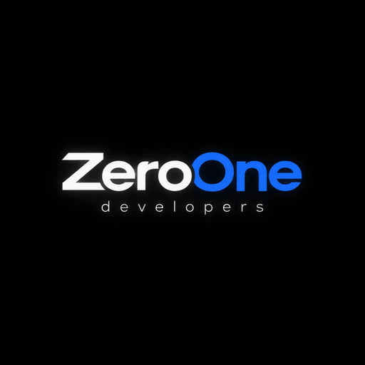
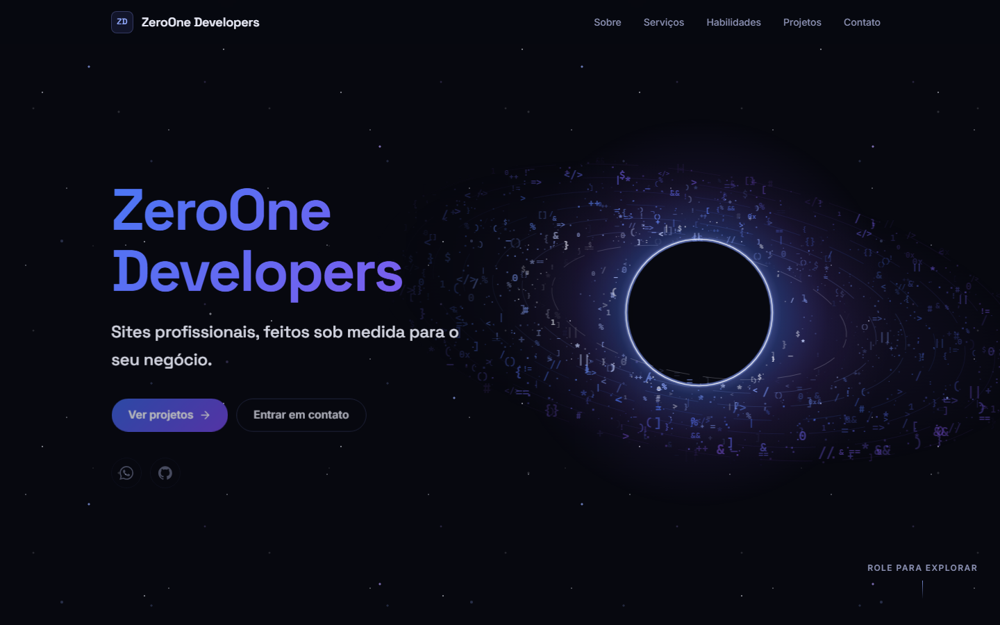

<div align="center">



# ZeroOne Developers

**Sites profissionais, feitos sob medida para o seu negócio.**

Site institucional e portfólio da ZeroOne Developers, estúdio de criação de sites, landing pages, lojas virtuais e automações.

[](https://zerone.dev.br)
[](https://wa.me/5512981548193)


<br />



</div>

<br />

## ✨ Destaques

- 🌌 **Visual próprio:** tema escuro estrelado com parallax e um buraco negro animado em `<canvas>`, cercado de símbolos de código que orbitam como um disco de acreção de verdade.
- ⚡ **Rápido e encontrável:** página gerada em HTML estático pelo Astro, com meta tags, Open Graph, dados estruturados (JSON-LD), `robots.txt` e `sitemap.xml` gerados sozinhos.
- 📝 **Tudo editável num lugar só:** textos, serviços, projetos e depoimentos ficam em arquivos de dados; nenhum componente precisa ser alterado.
- ♿ **Acessível:** navegação por teclado, foco visível, leitores de tela e respeito a `prefers-reduced-motion`.

## 🚀 Como rodar

Requisitos: **Node.js 22.22** ou superior e npm.

```bash
npm install
npm run dev
```

O site abre em **http://localhost:4321**.

| Comando           | O que faz                                              |
| ----------------- | ------------------------------------------------------ |
| `npm run dev`     | Servidor de desenvolvimento com recarga imediata       |
| `npm run build`   | Gera a versão de produção (pré-renderizada) em `dist/` |
| `npm run preview` | Serve a pasta `dist/` localmente para conferir         |
| `npm run lint`    | Verifica o código com ESLint                           |

## 🧩 Seções do site

| Seção           | De onde vêm os dados                                   |
| --------------- | ------------------------------------------------------ |
| Início          | `name`, `slogan`, `greeting`, `whatsapp`, `socials`    |
| Sobre           | `about`, `pillars` (missão, visão e valores), `logo`   |
| Serviços        | `services`                                             |
| Habilidades     | `skillGroups`                                          |
| Projetos        | [`src/data/projects.js`](src/data/projects.js)         |
| Depoimentos     | `testimonials`                                         |
| Contato         | `contactText`, `whatsapp`, `email`, `socials`          |

Tudo que não é projeto fica em [`src/data/profile.js`](src/data/profile.js).

## ➕ Adicionar um projeto

1. Salve uma imagem do site em `public/projects/` (ex.: `public/projects/meu-cliente.jpg`). Proporção recomendada: 16:10.
2. Acrescente um objeto **no topo** do array em [`src/data/projects.js`](src/data/projects.js):

```js
{
  id: 'meu-cliente',                   // único
  title: 'Nome da empresa',
  category: 'Site institucional',      // opcional
  description: 'Resumo em 1 a 3 frases.',
  tags: ['HTML', 'CSS', 'JavaScript'], // aparecem no card e no detalhe
  image: '/projects/meu-cliente.jpg',  // opcional
  liveUrl: 'https://meucliente.com.br',
  featured: true,                      // opcional; vai para o início com selo "Destaque"
  year: 2026,                          // opcional
  caseStudy: {                         // opcional; aparece ao abrir o projeto
    challenge: 'O problema do cliente.',
    solution: 'O que construímos.',
    result: 'O que mudou depois.',
  },
},
```

<details>
<summary><b>Como cada campo se comporta</b></summary>

<br />

- **Ordem:** destaques primeiro; entre os demais vale a ordem do array. Todos os projetos aparecem.
- **`tags`** são as tecnologias usadas no projeto.
- **`image`** ausente, ou que falha ao carregar, vira uma miniatura com a inicial do título.
- **`description`** é cortada em três linhas no card e aparece inteira no detalhe.
- **`caseStudy`** aparece no detalhe como Desafio, Solução e Resultado; cada etapa é opcional.
- Com o array vazio, a seção mostra uma mensagem amigável.

</details>

## 💬 Adicionar um depoimento

Acrescente um objeto **no topo** de `testimonials`, em [`src/data/profile.js`](src/data/profile.js):

```js
{
  quote: 'O que o cliente disse.',
  name: 'Nome do cliente',
  role: 'Proprietária',               // opcional
  company: 'Nome da empresa',
},
```

No card aparece `role, company` abaixo do nome. Todos os depoimentos do array aparecem; com o array vazio, a seção some.

<details>
<summary><b>⚙️ Outros campos de <code>profile.js</code></b></summary>

<br />

| Campo                    | Onde aparece                                                        |
| ------------------------ | ------------------------------------------------------------------- |
| `name`, `slogan`         | Topo, header, rodapé e meta tags                                    |
| `seoTitle`, `tagline`    | Título da aba e descrição nas buscas e compartilhamentos            |
| `greeting`               | Texto curto acima do nome no topo. Vazio esconde a linha            |
| `logo`                   | Seção "Sobre". Vazio mostra um bloco com as iniciais                |
| `highlights`             | Números em destaque no "Sobre". Vazio esconde o bloco               |
| `whatsapp`               | Botão "Chamar no WhatsApp" e ícone no topo                          |
| `email`                  | Link no Contato e nos dados de SEO. Vazio esconde                   |
| `socials`                | Ícones de redes no topo e no Contato                                |
| `siteUrl`, `ogImage`     | Meta tags, dados estruturados, `robots.txt` e `sitemap.xml`         |

- **WhatsApp:** `whatsapp.number` é DDI + DDD + número, só dígitos. `whatsapp.message` é o texto que já vem escrito na conversa. Com o número vazio, o botão some e o e-mail (se houver) vira o botão principal.
- **Redes sociais:** `github` e `linkedin` têm logo próprio; outros `id` usam um ícone genérico. Para um logo novo, inclua o SVG em `src/components/ui/BrandIcon.jsx`.
- **Imagem de compartilhamento:** 1200x630 px em `public/og-image.png`.

</details>

<details>
<summary><b>🎨 Personalizar o visual</b></summary>

<br />

Cores, tipografia, espaçamentos, raios e tempos de animação são variáveis CSS em [`src/styles/tokens.css`](src/styles/tokens.css). Os componentes usam só esses tokens, então mudar um valor ali muda o site inteiro.

- **Fundo estrelado:** [`src/styles/starfield.css`](src/styles/starfield.css), com parallax sutil sincronizado com a rolagem. Densidade e cores nos tokens `--stars-*` e `--star-*`.
- **Buraco negro do topo:** desenhado em `<canvas>` por [`src/components/Hero/heroScene.js`](src/components/Hero/heroScene.js). A matéria orbita mais rápido perto do centro, cai em espiral e o lado que vem em direção a quem olha fica mais claro (efeito Doppler). No começo do arquivo dá para ajustar velocidades (`OUTER_ORBIT_SECONDS`, `HALO_ORBIT_SECONDS`, `INNER_ORBIT_SPEED`), inclinação (`TILT`, `ROLL`), tamanhos, quantidade de partículas e símbolos (`SYMBOLS`, `TOKENS`). A animação pausa fora da tela.
- **Quebras entre seções:** linha fina que some nas bordas (`--divider-soft` em `tokens.css`).
- **Rolagem suave:** Lenis, em [`src/components/ui/SmoothScroll.jsx`](src/components/ui/SmoothScroll.jsx). A roda do mouse encaixa em cada seção; toque continua nativo. Para desligar, remova `<SmoothScroll />` de `src/App.jsx`.

</details>

## 🔍 SEO

Gerado a partir de `profile.js` a cada `npm run build`, sem editar HTML:

- **HTML estático:** buscadores leem o conteúdo sem executar JavaScript.
- **Meta tags:** título, descrição, canonical, `robots`, `hreflang`, Open Graph e Twitter Card.
- **Dados estruturados:** a empresa como `ProfessionalService`, com serviços, contato e redes, mais o `WebSite`.
- **`robots.txt` e `sitemap.xml`:** rotas em `src/pages/`, a partir de `profile.siteUrl`.

Depois de publicar, cadastre o site no [Google Search Console](https://search.google.com/search-console) e envie o `sitemap.xml`; no [Bing Webmaster Tools](https://www.bing.com/webmasters) dá para importar direto do Google. Ao ligar um domínio próprio, troque `siteUrl` e faça um novo deploy.

## ☁️ Deploy

O site roda em **https://zerone.dev.br**, numa VPS com nginx (`194.61.238.81`, a mesma da NexIU). O DNS fica no Cloudflare em modo "DNS only" (nuvem cinza), apontando `zerone.dev.br` e `www` para o IP.

```bash
bash deploy/deploy.sh
```

O script gera o build, envia para `/var/www/zerone/releases/<data>` e troca o link `current` de uma vez, guardando as 5 últimas versões. Usa o alias `nexiu` do `~/.ssh/config` (ou `DEPLOY_HOST=usuario@ip`).

A configuração do servidor está versionada em [`deploy/nginx/`](deploy/nginx/):

- **`zerone.conf`** → `/etc/nginx/sites-available/zerone`: http e www redirecionam (301) para `https://zerone.dev.br`, gzip, cache de 1 ano para `/_astro/`, 30 dias para imagens, HTML sempre revalidado e página 404 própria.
- **`zerone-headers.conf`** → `/etc/nginx/snippets/`: HSTS e cabeçalhos de segurança.
- **HTTPS:** Let's Encrypt via `certbot --webroot` (`/var/www/letsencrypt`), renovado sozinho pelo `certbot.timer`.

Depois de editar a config: envie o arquivo, rode `nginx -t` e só então `systemctl reload nginx`.

## 🗂️ Estrutura

```
.
├── astro.config.mjs            # Astro + integração React
├── deploy/                     # deploy.sh e config do nginx da VPS
├── public/
│   ├── logo.png, og-image.png  # logo e imagem de compartilhamento
│   └── projects/               # imagens dos projetos
└── src/
    ├── pages/                  # página inicial, robots.txt e sitemap.xml
    ├── layouts/BaseLayout.astro # <head>, SEO, JSON-LD e animações de entrada
    ├── App.jsx                 # monta as seções
    ├── components/
    │   ├── Header/  Hero/  About/  Services/  Skills/
    │   ├── Projects/           # galeria, modal e miniaturas
    │   ├── Testimonials/       # depoimentos
    │   ├── Contact/  Footer/
    │   └── ui/                 # Button, Chip, Section, Reveal, SmoothScroll...
    ├── data/
    │   ├── profile.js          # dados da empresa e depoimentos
    │   ├── projects.js         # projetos do portfólio
    │   └── navigation.js       # ids das seções e links do menu
    ├── hooks/                  # useActiveSection, useReducedMotion, useFocusTrap...
    ├── utils/                  # getWhatsAppUrl, motion...
    └── styles/                 # tokens, fontes, global e fundo estrelado
```

## ♿ Acessibilidade e movimento

- Navegação completa por teclado, foco visível e link "Pular para o conteúdo".
- Menu mobile e modal de projeto fecham com `Esc` ou clique fora; o modal prende e devolve o foco.
- Com `prefers-reduced-motion`, a rolagem suave e os deslocamentos são desligados e as entradas ficam só com fade.

<br />

<div align="center">

Feito com 💜 pela **ZeroOne Developers**

</div>
